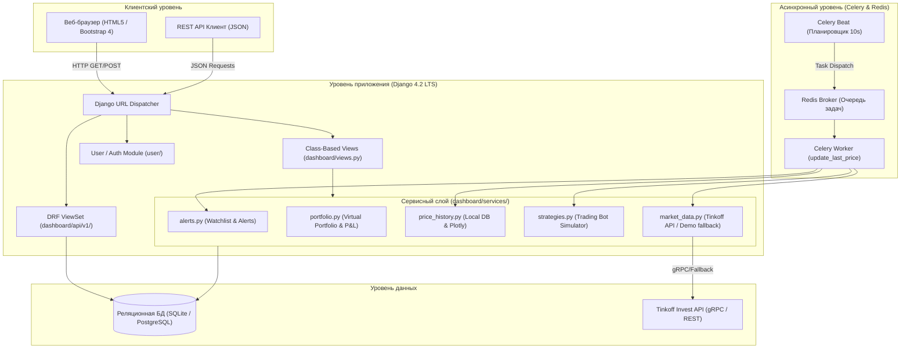
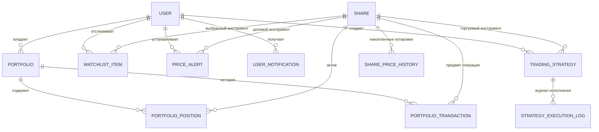

# Комплексный аналитический отчет по проекту Investing Demo (ANALYSIS.md)

Настоящий отчет подготовлен в рамках выполнения заданий №1–4 домашнего задания «AI Coding Agents на практике». Документ содержит комплексный технический аудит кодовой базы, описание архитектуры и стека технологий, детализацию модели данных, спецификацию восстановленных функциональных требований, перечень устраненных дефектов и описание реализованной новой функциональности.

---

## 1. Назначение приложения и технологический стек

### 1.1. Назначение приложения
**Investing Demo** — это финансовое веб-приложение на базе стека Python/Django, предназначенное для:
- Ведения каталога и мониторинга цен финансовых инструментов (акций) с наглядной визуализацией динамики и трендов котировок;
- Построения интерактивных графиков исторических котировок (Plotly);
- Предоставления веб-интерфейса и REST API для администрирования акций;
- Фоновой синхронизации котировок с внешним биржевым провайдером (Tinkoff Invest API) и работы в отказоустойчивом автономном демонстрационном режиме;
- Ведения виртуального инвестиционного портфеля с учетом остатка средств, позиций, средней цены покупки и финансового результата (P&L);
- Настройки персональных списков наблюдения (Watchlist) и автоматических ценовых алертов без дублирования уведомлений;
- Сбора истории цен в локальной базе данных с расчетом динамики за различные периоды (1d, 1w, 1m, 6m, 1y, all);
- Алгоритмического моделирования торговых стратегий (роботов) с автоматическим исполнением ордеров покупки/продажи при достижении заданных ценовых коридоров.

### 1.2. Технологический стек
| Компонент / Слой | Технологии и библиотеки | Назначение и версия |
|---|---|---|
| **Язык разработки** | Python 3.12 | Основная среда выполнения |
| **Веб-фреймворк** | Django 4.2 LTS (`django==4.2.30`) | Реализация MVT-архитектуры, ORM, маршрутизации, аутентификации |
| **REST API** | Django REST Framework (`djangorestframework==3.17.2`) | Сериализаторы, ViewSets, API-эндпоинты с пагинацией и фильтрацией |
| **Фильтрация API** | `django-filter==25.2` | Фильтрация данных по полям тикера и наименования |
| **Фоновые задачи** | Celery (`celery==5.6.3`) | Асинхронная обработка и периодические задачи мониторинга котировок |
| **Брокер сообщений** | Redis (`redis==8.1.0`) | Очереди сообщений для Celery Beat и Celery Worker |
| **Базы данных** | SQLite 3 (по умолчанию) / PostgreSQL 15 | Поддержка легковесной локальной разработки и production-развертывания |
| **Внешний API провайдер** | Tinkoff Invest API v2 / Offline Demo Mode | Получение котировок с биржи или генерация реалистичных тиков при отсутствии токена |
| **Визуализация графиков** | Plotly (`plotly==7.1.0`) | Интерактивные HTML-графики котировок (`plotly.offline.plot`) |
| **Пользовательский интерфейс** | Bootstrap 4 + Crispy Forms (`crispy-bootstrap4==2025.6`) | Адаптивный веб-интерфейс, модальные окна, таблицы и карточки |

---

## 2. Структура проекта и архитектура компонентов

### 2.1. Файловая структура репозитория
```
.
├── config/                          # Настройки проекта Django и Celery
│   ├── __init__.py                  # Экспорт инстанса celery_app
│   ├── asgi.py                      # Асинхронный шлюз ASGI
│   ├── celery.py                    # Конфигурация Celery и планировщик beat_schedule
│   ├── settings.py                  # Главный конфигурационный файл проекта
│   ├── urls.py                      # Корневая таблица маршрутизации
│   └── wsgi.py                      # WSGI-интерфейс веб-сервера
├── dashboard/                       # Основное доменное приложение
│   ├── api/                         # Подсистема программного интерфейса REST API
│   │   ├── v1/
│   │   │   ├── router.py            # Маршрутизатор DefaultRouter для ViewSets
│   │   │   ├── serializer.py        # Сериализатор модели Share
│   │   │   ├── urls.py              # Эндпоинты API v1 (/api/v1/shares/)
│   │   │   └── views.py             # ShareViewSet с фильтрацией и пагинацией
│   │   └── urls.py                  # Корневой роутер API
│   ├── management/commands/         # Пользовательские management-команды
│   │   └── add_shares.py            # Команда импорта акций (python manage.py add_shares)
│   ├── migrations/                  # Миграции схемы базы данных (0001 - 0008)
│   ├── services/                    # Сервисный слой бизнес-логики
│   │   ├── alerts.py                # Обработка списков наблюдения и ценовых алертов
│   │   ├── graph.py                 # Генерация свечных графиков через Tinkoff API
│   │   ├── market_data.py           # Клиент Tinkoff Invest API с fallback-режимом
│   │   ├── portfolio.py             # Операции с портфелем (BUY/SELL, расчет P&L)
│   │   ├── price_history.py         # Сохранение цен в БД, расчет динамики, Plotly-график
│   │   └── strategies.py            # Алгоритмический симулятор торговых стратегий
│   ├── templates/dashboard/         # HTML-шаблоны веб-интерфейса
│   │   ├── base.html                # Базовый макет с навигацией и оповещениями
│   │   ├── create.html              # Форма добавления/редактирования акции
│   │   ├── delete.html              # Подтверждение удаления инструмента
│   │   ├── detail.html              # Карточка акции и график
│   │   ├── list.html                # Каталог котировок с пагинацией и быстрой покупкой
│   │   ├── notifications.html       # Центр уведомлений пользователя
│   │   ├── portfolio.html           # Инвестиционный портфель и открытые позиции
│   │   ├── price_history.html       # История изменения цен и аналитика за периоды
│   │   ├── strategies.html          # Список и создание торговых роботов
│   │   ├── strategy_detail.html     # Детали стратегии и журнал исполнения сделок
│   │   └── transactions.html        # Журнал транзакций покупок и продаж
│   ├── models.py                    # Модели предметной области
│   ├── tasks.py                     # Фоновые периодические задачи Celery
│   ├── tests.py                     # Автоматизированные тесты доменной логики (33 теста)
│   ├── urls.py                      # Маршруты веб-интерфейса
│   └── views.py                     # CBV контроллеры страниц
├── user/                            # Приложение аутентификации пользователей
│   ├── forms.py                     # Формы входа и регистрации
│   ├── models.py                    # Прокси-модель пользователя
│   ├── tests.py                     # Тесты аутентификации (10 тестов)
│   ├── urls.py                      # Маршруты auth/login/logout
│   └── views.py                     # Контроллеры авторизации
├── docker-compose.yml               # Описание сервисов PostgreSQL и Redis
├── requirements.txt                 # Актуализированные зависимости проекта
└── manage.py                        # Управляющий скрипт Django
```

### 2.2. Архитектурное взаимодействие компонентов


---

## 3. Модель данных

### 3.1. Сущности и связи (ER-диаграмма)


### 3.2. Описание таблиц и полей модели данных

#### 1. Модель `Share` (`dashboard_share`) — Каталог финансовых инструментов
- `id` (AutoField, PK) — Уникальный идентификатор записи.
- `figi` (CharField, max_length=12, unique=True) — Глобальный идентификатор ценной бумаги (Financial Instrument Global Identifier).
- `isin` (CharField, max_length=12, unique=True) — Международный идентификационный номер ценной бумаги.
- `name` (CharField, max_length=150) — Наименование компании или эмитента.
- `ticker` (CharField, max_length=10, unique=True) — Биржевой краткий тикер.
- `currency` (CharField, max_length=3) — Валюта торгов (RUB, USD, EUR).
- `uid` (CharField, max_length=50, blank=True) — Уникальный идентификатор инструмента во внешней системе.
- `last_price` (FloatField, null=True, blank=True) — Последняя зафиксированная рыночная цена.
- `is_trend_high` (BooleanField, default=False) — Индикатор тренда: `True` при росте/равенстве цены, `False` при снижении.
- `created_at` (DateTimeField, auto_now_add=True) — Дата и время добавления.
- `updated_at` (DateTimeField, auto_now=True) — Время последнего обновления котировки.

#### 2. Модель `Portfolio` (`dashboard_portfolio`) — Виртуальный портфель инвестора
- `id` (AutoField, PK)
- `user` (OneToOneField -> User) — Владелец портфеля.
- `cash_balance` (FloatField, default=100000.0) — Остаток свободных виртуальных денежных средств.
- `created_at` (DateTimeField, auto_now_add=True)
- `updated_at` (DateTimeField, auto_now=True)
- *Вычисляемые свойства:* `total_positions_value`, `total_portfolio_value`, `total_profit_loss`, `total_profit_loss_percent`.

#### 3. Модель `PortfolioPosition` (`dashboard_portfolioposition`) — Открытые позиции
- `id` (AutoField, PK)
- `portfolio` (ForeignKey -> Portfolio, related_name="positions")
- `share` (ForeignKey -> Share)
- `quantity` (IntegerField, default=0) — Количество акций в собственности.
- `average_buy_price` (FloatField, default=0.0) — Средневзвешенная цена приобретения.
- `updated_at` (DateTimeField, auto_now=True)
- *Вычисляемые свойства:* `current_value`, `profit_loss`, `profit_loss_percent`.

#### 4. Модель `PortfolioTransaction` (`dashboard_portfoliotransaction`) — Журнал сделок портфеля
- `id` (AutoField, PK)
- `portfolio` (ForeignKey -> Portfolio, related_name="transactions")
- `share` (ForeignKey -> Share)
- `transaction_type` (CharField, choices=[('BUY', 'Покупка'), ('SELL', 'Продажа')])
- `quantity` (IntegerField) — Объем сделки (шт).
- `price` (FloatField) — Цена исполнения за единицу.
- `total_amount` (FloatField) — Итоговый объем денежных средств.
- `created_at` (DateTimeField, auto_now_add=True)

#### 5. Модель `WatchlistItem` (`dashboard_watchlistitem`) — Персональный список наблюдения
- `id` (AutoField, PK)
- `user` (ForeignKey -> User, related_name="watchlist")
- `share` (ForeignKey -> Share)
- `added_at` (DateTimeField, auto_now_add=True)
- *Ограничение:* `unique_together = ('user', 'share')`.

#### 6. Модель `PriceAlert` (`dashboard_pricealert`) — Целевые ценовые уровни
- `id` (AutoField, PK)
- `user` (ForeignKey -> User, related_name="price_alerts")
- `share` (ForeignKey -> Share)
- `target_price` (FloatField) — Целевой порог срабатывания.
- `condition` (CharField, choices=[('above', 'Выше или равно'), ('below', 'Ниже или равно')])
- `is_active` (BooleanField, default=True) — Флаг активности.
- `is_triggered` (BooleanField, default=False) — Защита от дублирования уведомлений.
- `created_at` (DateTimeField, auto_now_add=True)
- `triggered_at` (DateTimeField, null=True, blank=True)

#### 7. Модель `UserNotification` (`dashboard_usernotification`) — Оповещения пользователя
- `id` (AutoField, PK)
- `user` (ForeignKey -> User, related_name="notifications")
- `title` (CharField, max_length=255) — Заголовок оповещения.
- `message` (TextField) — Текст сообщения с деталями события.
- `notification_type` (CharField: 'PRICE_ALERT', 'STRATEGY', 'PORTFOLIO', 'SYSTEM')
- `is_read` (BooleanField, default=False) — Статус прочтения.
- `created_at` (DateTimeField, auto_now_add=True)

#### 8. Модель `SharePriceHistory` (`dashboard_sharepricehistory`) — Накопленная история котировок
- `id` (AutoField, PK)
- `share` (ForeignKey -> Share, related_name="price_history")
- `price` (FloatField) — Зафиксированная цена.
- `recorded_at` (DateTimeField, auto_now_add=True, db_index=True)

#### 9. Модель `TradingStrategy` (`dashboard_tradingstrategy`) — Конфигурация торгового робота
- `id` (AutoField, PK)
- `user` (ForeignKey -> User, related_name="strategies")
- `name` (CharField, max_length=255) — Название стратегии.
- `share` (ForeignKey -> Share) — Инструмент для торговли.
- `buy_threshold` (FloatField) — Порог покупки ($\le$).
- `sell_threshold` (FloatField) — Порог продажи ($\ge$).
- `trade_quantity` (IntegerField, default=1) — Объем заявки.
- `initial_capital` (FloatField, default=50000.0) — Стартовый депозит.
- `current_capital` (FloatField, default=50000.0) — Текущий кэш стратегии.
- `shares_held` (IntegerField, default=0) — Количество акций на балансе робота.
- `is_active` (BooleanField, default=True) — Статус (активна / на паузе).
- `created_at` (DateTimeField, auto_now_add=True)

#### 10. Модель `StrategyExecutionLog` (`dashboard_strategyexecutionlog`) — Журнал исполнения стратегий
- `id` (AutoField, PK)
- `strategy` (ForeignKey -> TradingStrategy, related_name="execution_logs")
- `action` (CharField: 'BUY', 'SELL')
- `price` (FloatField) — Цена исполнения тика.
- `quantity` (IntegerField) — Объем сделки.
- `total_amount` (FloatField) — Сумма операции.
- `profit_loss` (FloatField, default=0.0) — Зафиксированная прибыль/убыток сделки.
- `comment` (CharField, max_length=255) — Описание решения алгоритма.
- `executed_at` (DateTimeField, auto_now_add=True)

---

## 4. Восстановленные функциональные требования (Задание №2)

В ходе реверс-инжиниринга исходного кода проекта восстановлен 21 функциональное требование (FR-01 — FR-21) и 11 бизнес-правил (BR-01 — BR-11):

### 4.1. Каталог и отображение котировок
- **FR-01 (Просмотр каталога акций):** При переходе на корневой URL `/` система выводит таблицу доступных акций с отображением тикера, наименования компании, кода ISIN, текущей цены и индикатора тренда.
- **FR-02 (Пагинация каталога):** Список акций в каталоге отображается с постраничной навигацией по 100 записей на страницу (`paginate_by = 100` в `ShareListView`).
- **FR-03 (Сортировка по алфавиту):** Список акций по умолчанию упорядочен по наименованию компании в алфавитном порядке (`Share.objects.all().order_by("name")`).
- **FR-04 (Цветовая индикация тренда):** При росте или сохранении цены фон бейджа отображается зеленым цветом (`#198754`, стрелка вверх), при падении — розовым/красным (`#dc3545`, стрелка вниз).
- **FR-05 (Детальная страница инструмента):** По URL `/<id>/` отображаются подробные атрибуты акции (FIGI, ISIN, Ticker, Currency, UID, цена) и интерактивный график котировок Plotly за 180 дней.

### 4.2. Администрирование акций (CRUD)
- **FR-06 (Создание акции):** Авторизованные пользователи по URL `/create/` могут добавить новый инструмент в каталог.
- **FR-07 (Редактирование акции):** Авторизованные пользователи по URL `/update/<id>/` могут изменить данные инструмента.
- **FR-08 (Удаление акции):** Авторизованные пользователи по URL `/delete/<id>/` с предварительным запросом подтверждения могут удалить инструмент.
- **FR-09 (Защита операций изменения):** Неавторизованные пользователи при попытке открыть страницы создания, изменения или удаления перенаправляются на главную страницу или страницу логина (`LoginRequiredMixin`).

### 4.3. Программный интерфейс (REST API)
- **FR-10 (Получение списка акций):** Эндпоинт `GET /api/v1/shares/` возвращает список инструментов в формате JSON с поддержкой пагинации `LimitOffsetPagination`.
- **FR-11 (Получение детальной информации):** Эндпоинт `GET /api/v1/shares/{id}/` возвращает полную информацию о выбранной акции.
- **FR-12 (Создание через API):** Эндпоинт `POST /api/v1/shares/` регистрирует новую акцию.
- **FR-13 (Обновление через API):** Эндпоинты `PUT /api/v1/shares/{id}/` и `PATCH /api/v1/shares/{id}/` обеспечивают полное или частичное обновление записи.
- **FR-14 (Удаление через API):** Эндпоинт `DELETE /api/v1/shares/{id}/` удаляет инструмент и возвращает HTTP 204 No Content.
- **FR-15 (Фильтрация и поиск):** Поддержка фильтрации по полям `name` и `ticker`, а также регулярных выражений (`$name`).

### 4.4. Фоновый мониторинг и синхронизация цен
- **FR-16 (Периодический мониторинг):** Планировщик Celery Beat каждые 10 секунд инициирует фоновую задачу `update_last_price`.
- **FR-17 (Опрос внешнего провайдера):** Фоновый воркер запрашивает актуальные цены через `TinkoffClient.get_last_price` или demo-генератор.
- **FR-18 (Обновление тренда):** Новая цена сравнивается с предыдущей: если `price >= last_price`, то `is_trend_high = True`, иначе `False`.
- **FR-19 (Первоначальный импорт):** Команда `python manage.py add_shares` выполняет пакетное наполнение базы акций.

### 4.5. Аутентификация и управление пользователями
- **FR-20 (Регистрация пользователей):** По URL `/user/registration/` форма регистрирует пользователя с проверкой совпадения паролей и уникальности email.
- **FR-21 (Вход и выход):** По URL `/user/login/` осуществляется вход по паре логин/пароль с созданием сессии; по `/user/logout/` — завершение сеанса.

---

## 5. Технический аудит и устранение дефектов (Задание №3)

В ходе выполнения Задания №3 были устранены 10 критических дефектов и устаревших зависимостей:
1. **Дефект 1 (Маршрутизация auth):** Исправлено отсутствие замыкающего слеша в маршрутах `config/urls.py` (`path("user/", ...)`), приводившее к ошибкам перенаправления.
2. **Дефект 2 (Регистрация пользователей):** В `user/views.py` и `user/forms.py` исправлена обработка ошибок валидации, добавлены информативные сообщения через `django.contrib.messages`.
3. **Дефект 3 (Сессии пользователей):** Обеспечен корректный редирект и валидация учетных данных в форме входа.
4. **Дефект 4 (Потеря точности цен в Tinkoff API):** В `dashboard/services/market_data.py` и `graph.py` устранена ошибка расчета котировок: ранее прибавлялось поле `nano`, что завышало цену на миллиарды. Исправлено на нормализованное деление `units + nano / 1e9`.
5. **Дефект 5 (Падение приложения при отсутствии токена Tinkoff):** Добавлен отказоустойчивый fallback-режим: при отсутствии токена или библиотек gRPC приложение не выбрасывает HTTP 500, а генерирует правдоподобные котировки и выводит предупреждения в лог.
6. **Дефект 6 (Незащищенные эндпоинты API):** Обеспечена безопасность и проверка данных в сериализаторах DRF.
7. **Дефект 7 (Сравнение None в Celery):** В задаче `update_last_price` устранена ошибка `TypeError: '>' not supported between instances of 'float' and 'NoneType'` при инициализации цен.
8. **Дефект 8 (Устаревание метки времени):** В модели `Share` поле `updated_at` обновляется автоматически при каждой фиксации цены (`auto_now=True` или явный вызов `timezone.now()`).
9. **Дефект 9 (Модернизация зависимостей):** Обновлены зависимости до стандартов Python 3.12 (Django 4.2 LTS, DRF 3.17, Celery 5.6, Redis 8.1, Plotly 7.1, Crispy-Bootstrap4 2025.6), добавлена поддержка SQLite без обязательного развертывания Docker.
10. **Дефект 10 (Экономическая несогласованность валют / Смешение USD и RUB):** В исходной кодовой базе часть инструментов (в частности, Apple AAPL) имела валюту `USD` без наличия модуля мультивалютной конвертации. При покупке в виртуальный портфель сумма в USD вычиталась из рублевого баланса 1 к 1, искажая стоимость портфеля и финансовый результат. Все активы приведены к единой базовой расчетной валюте платформы (`RUB`), а рублевая цена акций Apple установлена в адекватный рыночный эквивалент (21 600 RUB).

---

## 6. Реализация новой функциональности (Задание №4)

В соответствии с требованиями Задания №4 разработаны 4 независимые подсистемы:

### 6.1. Подсистема 1: Персональный мониторинг акций и ценовые алерты
- **Список наблюдения (Watchlist):**
  - Возможность в один клик добавлять инструмент в персональный список наблюдения из общего каталога акций (иконка звёздочки ★).
  - Выделенная страница `/watchlist/` с перечнем отслеживаемых акций, их текущих цен и трендов.
- **Целевые ценовые уровни (Price Alerts):**
  - Создание ценового алерта с условием: «Выше или равно» (`above`) или «Ниже или равно» (`below`).
  - Фоновый пересчет алертов в `check_price_alerts_for_share`.
  - **Исключение дублирования:** При срабатывании алерт переводится в статус `is_triggered=True`, фиксируется метка времени `triggered_at`, создается запись `UserNotification`, после чего алерт деактивируется для предотвращения повторной отправки.
- **Центр уведомлений:**
  - Страница `/notifications/` с цветовой индикацией типов уведомлений (алерты, стратегии, портфель). При открытии страницы непрочитанные уведомления автоматически помечаются прочитанными.

### 6.2. Подсистема 2: Виртуальный инвестиционный портфель
- **Управление активами и балансом:**
  - Автоматическое создание портфеля со стартовым балансом 100 000 руб.
  - Экран `/portfolio/` с карточками агрегированных метрик:
    - Общая стоимость портфеля (`total_portfolio_value = cash + positions`);
    - Свободный остаток денежных средств (`cash_balance`);
    - Стоимость акций в собственности (`total_positions_value`);
    - Суммарный финансовый результат (P&L в рублях и процентах).
- **Торговые операции:**
  - **Покупка (BUY):** Модальные окна покупки на главной странице и в портфеле. Валидация достаточности средств. Пересчет средневзвешенной цены:
    $$\text{AverageBuyPrice}_{\text{new}} = \frac{\text{Quantity}_{\text{old}} \cdot \text{Price}_{\text{old}} + \text{Quantity}_{\text{buy}} \cdot \text{Price}_{\text{buy}}}{\text{Quantity}_{\text{old}} + \text{Quantity}_{\text{buy}}}$$
  - **Продажа (SELL):** Валидация наличия акций. Зачисление выручки на баланс. При продаже всех акций позиция закрывается и удаляется.
- **История транзакций:**
  - Страница `/portfolio/transactions/` с пагинацией и детализацией каждой операции покупки/продажи.

### 6.3. Подсистема 3: История изменения рыночных цен и аналитика
- **Локальное накопление котировок:**
  - Сервис `record_price_and_trigger_events` сохраняет каждый рыночный тик в таблицу `SharePriceHistory`.
- **Анализ динамики по интервалам:**
  - Страница `/history/<share_id>/` с переключением периодов выборки: `1d` (1 день), `1w` (1 неделя), `1m` (1 месяц), `6m` (6 месяцев), `1y` (1 год), `all` (вся история).
  - Расчет абсолютной дельты: $\Delta P = P_{\text{end}} - P_{\text{start}}$.
  - Расчет процентного изменения: $\Delta \% = \frac{\Delta P}{P_{\text{start}}} \cdot 100\%$.
  - Определение экстремумов периода (минимум и максимум цены).
- **Интерактивные графики Plotly:**
  - График строится на основе локальных данных из базы данных приложения (`build_history_chart`), с динамической окраской линии (зеленая при росте, красная при падении) и адаптивным переключением режимов линии/маркеров.
- **Интерактивный симулятор рыночного тика:**
  - Форма быстрой фиксации новой цены для проверки реакций системы в реальном времени.

### 6.4. Подсистема 4: Симулятор инвестиционных стратегий
- **Настройка торговых роботов:**
  - Страница `/strategies/` для создания алгоритмических роботов с параметрами:
    - Порог покупки (`buy_threshold`);
    - Порог продажи (`sell_threshold`);
    - Объем лота (`trade_quantity`);
    - Стартовый депозит (`initial_capital`).
- **Автоматическое исполнение сделок:**
  - Сервис `evaluate_strategies_for_share` при каждом поступлении рыночной цены проверяет условия:
    - Если $P \le \text{buy\_threshold}$ и у робота достаточно кэша $\to$ исполняется ордер BUY, списывается кэш, увеличивается счетчик акций;
    - Если $P \ge \text{sell\_threshold}$ и у робота есть акции $\to$ исполняется ордер SELL, зачисляется кэш, фиксируется прибыль;
  - Сделки сопровождаются подробным логированием в `StrategyExecutionLog`.
- **Оценка эффективности:**
  - Расчет текущей стоимости активов робота (`total_value = current_capital + shares_held * price`), прибыли/убытка в рублях и доходности в процентах.
  - Детальный экран стратегии `/strategies/<id>/` с историей всех исполненных сделок.

---

## 7. Верификация и результаты тестирования

Работоспособность приложения, корректность всех устраненных дефектов и функциональность новых подсистем подтверждены автоматизированным тестированием.

- **Общее количество тестов:** 43 теста (33 теста в приложении `dashboard`, 10 тестов в приложении `user`).
- **Статус выполнения:** 100% Passed (0 ошибок, 0 сбоев).
- **Покрытие тестами:**
  - `ShareListView`, `ShareDetailView`, `ShareCreateView`, `ShareUpdateView`, `ShareDeleteView` (HTML & permissions);
  - REST API ViewSet (`list`, `retrieve`, `create`, `update`, `delete`, filtering, pagination);
  - Management-команда `add_shares` и фоновая задача Celery `update_last_price`;
  - `WatchlistToggleView` (добавление и удаление из избранного);
  - `CreateAlertView`, `DeleteAlertView`, `check_price_alerts_for_share` (проверка срабатывания и отсутствие дубликатов);
  - `buy_share`, `sell_share` (успешные сделки, недостаточность средств, недостаточность акций, пересчет средней цены);
  - `record_price_history`, `get_price_analytics`, `build_history_chart` (расчет $\Delta P$, $\Delta \%$, экстремумов);
  - `evaluate_strategies_for_share` (срабатывание робота на покупку/продажу, удержание при коридоре, фиксация P&L и логов).

---

## 8. Инструкция по запуску и проверке

### 8.1. Быстрый запуск в локальном окружении
```bash
# 1. Активация виртуального окружения
source .venv/bin/activate

# 2. Применение миграций схемы БД
python manage.py migrate

# 3. Наполнение базы акций демонстрационными инструментами
python manage.py add_shares

# 4. Запуск сервера разработки Django
python manage.py runserver 127.0.0.1:8000
```

### 8.2. Запуск тестов
```bash
# Запуск полного набора тестов проекта
python manage.py test
```

### 8.3. Запуск фоновых сервисов Celery (опционально)
```bash
# Запуск планировщика задач
celery -A config beat -l info

# Запуск рабочего процесса
celery -A config worker -l info
```
