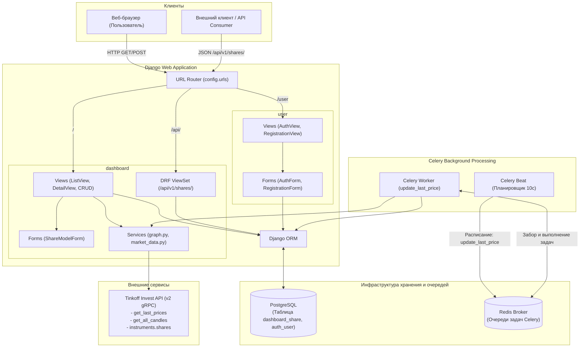

# Анализ исходного кода проекта Investing Demo

Данный документ содержит результаты выполнения **Задания №1** по исследованию архитектуры, структуры и исходного кода приложения **Investing Demo**.

---

## 1. Назначение приложения и технологический стек

### 1.1. Назначение приложения
**Investing Demo** — это веб-приложение на базе Django, предназначенное для мониторинга финансовых инструментов (акций) и отслеживания динамики котировок.

Основные задачи приложения:
- Отображение списка доступных акций с актуальными ценами и индикатором рыночного тренда (рост/падение).
- Детальный просмотр финансового инструмента с построением интерактивного графика исторических котировок (свечей) за последние 180 дней.
- Управление базой акций (добавление, редактирование, удаление инструментов администратором или авторизованным пользователем).
- Периодическое фоновое обновление текущих рыночных цен через интеграцию с внешним биржевым API.
- Предоставление программного REST API для интеграции и CRUD-операций с акциями.
- Базовая аутентификация и регистрация пользователей.

### 1.2. Технологический стек
| Уровень / Компонент | Технология / Библиотека | Назначение |
|---|---|---|
| **Язык программирования** | Python 3.10–3.12 | Основной язык реализации проекта |
| **Веб-фреймворк** | Django 4.1.7 | Реализация MVT-архитектуры, ORM, маршрутизации, аутентификации |
| **REST API** | Django REST Framework (DRF) 3.14.0 | Реализация сериализаторов, ViewSet и REST эндпоинтов |
| **Фильтрация API** | django-filter 22.1 | Фильтрация данных в DRF-эндпоинтах |
| **Фоновые задачи** | Celery 5.2.7 | Асинхронное и периодическое выполнение задач обновления котировок |
| **Брокер сообщений** | Redis 4.5.1 / amqp | Транспорт и хранение очередей для Celery Beat и Celery Worker |
| **База данных** | PostgreSQL | Основная реляционная СУБД (драйвер `psycopg2-binary==2.9.5`) |
| **Внешний API провайдер** | Tinkoff Invest API v2 (`tinkoff-investments==0.2.0b50`, `grpcio==1.51.3`, `protobuf==3.20.3`) | Получение рыночных котировок, инструментов и свечей по протоколу gRPC |
| **Визуализация данных** | Plotly 5.13.1 | Построение интерактивных графиков котировок в HTML (`plotly.offline.plot`) |
| **UI / Шаблоны** | Django Templates + Bootstrap (crispy-forms 2.0, crispy-bootstrap3) | Серверный рендеринг веб-интерфейса, стилизация форм и страниц |
| **Контейнеризация** | Docker Compose | Локальное развертывание сервисов СУБД PostgreSQL и брокера Redis |

---

## 2. Структура проекта, основные компоненты и их назначение

```
.
├── config/                          # Пакет конфигурации проекта Django
│   ├── __init__.py                  # Экспорт приложения Celery
│   ├── asgi.py                      # Конфигурация ASGI
│   ├── celery.py                    # Конфигурация Celery и расписание Celery Beat
│   ├── settings.py                  # Основные настройки проекта
│   ├── urls.py                      # Корневой маршрутизатор URL
│   └── wsgi.py                      # Конфигурация WSGI
├── dashboard/                       # Основное приложение: акции, графики, API
│   ├── api/                         # Подсистема REST API
│   │   ├── __init__.py
│   │   ├── urls.py                  # Маршруты API верхнего уровня (/api/v1/)
│   │   └── v1/
│   │       ├── __init__.py
│   │       ├── router.py            # Настройка DefaultRouter для ViewSets
│   │       ├── serializer.py        # Сериализатор модели Share (ShareSerializer)
│   │       ├── urls.py              # URL-маршруты API v1
│   │       └── views.py             # ShareViewSet и ShareFilter
│   ├── management/                  # Пользовательские management-команды
│   │   └── commands/
│   │       └── add_shares.py        # Команда первоначального импорта акций из Tinkoff API
│   ├── migrations/                  # Миграции базы данных для модели Share (0001-0007)
│   ├── services/                    # Сервисный слой бизнес-логики
│   │   ├── graph.py                 # Построение графиков свечей через Plotly
│   │   └── market_data.py           # Запрос последней цены акции через Tinkoff API
│   ├── static/dashboard/            # Статические файлы (CSS bootstrap, navbar)
│   ├── templates/dashboard/         # HTML-шаблоны приложения dashboard
│   │   ├── base.html                # Базовый макет с навигационной панелью и подвалом
│   │   ├── list.html                # Список акций с индикаторами тренда и пагинацией
│   │   ├── detail.html              # Детальная страница акции с интерактивным графиком
│   │   ├── create.html              # Форма добавления/редактирования акции
│   │   └── delete.html              # Страница подтверждения удаления акции
│   ├── admin.py                     # Регистрация модели Share в панели администратора Django
│   ├── apps.py                      # Конфигурация приложения DashboardConfig
│   ├── forms.py                     # ShareModelForm (форма на базе модели Share)
│   ├── models.py                    # Модель Share
│   ├── tasks.py                     # Фоновая Celery-задача update_last_price
│   ├── tests.py                     # Интеграционные тесты для REST API и HTML-представлений
│   └── urls.py                      # Маршрутизация приложения dashboard
├── user/                            # Приложение аутентификации и профилей
│   ├── static/user/                 # Статические файлы стилей авторизации
│   ├── templates/user/              # Шаблоны авторизации и регистрации
│   │   ├── base.html                # Базовый шаблон авторизации
│   │   ├── auth.html                # Страница входа
│   │   └── registration.html        # Страница регистрации
│   ├── apps.py                      # Конфигурация приложения UserConfig
│   ├── forms.py                     # Формы AuthForm и RegistrationForm
│   ├── models.py                    # Импорт стандартной модели Django User
│   ├── urls.py                      # Маршрутизация входа, регистрации, выхода
│   └── views.py                     # Представления AuthView, RegistrationView, LogoutView
├── docker-compose.yml               # Описание сервисов PostgreSQL и Redis
├── manage.py                        # Управляющий скрипт Django
├── requirements.txt                 # Зависимости Python
├── README.md                        # Инструкция по запуску проекта
└── HOMEWORK.md                      # Техническое задание
```

---

## 3. Архитектура приложения и взаимодействие компонентов

Приложение спроектировано по архитектурному паттерну **Monolithic Layered Architecture** (монолитная слоистая архитектура) на платформе Django (MVT — Model-View-Template), дополненная:
1. **Слоем REST API** (на базе Django REST Framework) для программного доступа к данным.
2. **Асинхронным контуром фоновой обработки** (Celery Worker + Celery Beat + Redis) для периодического опроса биржевых котировок.
3. **Сервисным слоем (`services/`)** для изоляции интеграции с внешними API (`tinkoff.invest`) и генерации графиков (`plotly`).

### 3.1. Архитектурная схема взаимодействия



### 3.2. Основные сценарии взаимодействия компонентов

1. **Просмотр каталога акций**:
   - Браузер отправляет `GET /`.
   - `ShareListView` запрашивает через ORM пагинированный список `Share` из PostgreSQL с сортировкой по имени.
   - Сервер рендерит HTML-шаблон `dashboard/list.html` с визуальным выделением динамики цен (зеленый при `is_trend_high=True`, розовый при `False`).

2. **Детальный просмотр и график котировок**:
   - Браузер отправляет `GET /<pk>`.
   - `ShareDetailView` извлекает объект акции по ID из базы.
   - Вызывается синхронный сервис `get_graph(share)`, который открывает gRPC-сессию к Tinkoff Invest API, запрашивает дневные свечи за 180 дней (`get_all_candles`), строит Scatter-график через Plotly и возвращает сгенерированный HTML div.
   - Страница рендерится в `dashboard/detail.html`.

3. **Фоновое обновление котировок**:
   - `Celery Beat` по интервалу (в коде задано 10 секунд) ставит задачу `dashboard.tasks.update_last_price` в Redis.
   - `Celery Worker` получает задачу, выполняет `Share.objects.all()`.
   - В цикле по каждой акции вызывает `get_last_data(share)` -> запрос последней цены через Tinkoff API.
   - Вычисляет изменение: если новая цена меньше предыдущей, то `is_trend_high = False`, иначе `True`.
   - Обновляет запись в PostgreSQL методом `Share.objects.filter(id=share.id).update(...)`.

4. **Первоначальный импорт акций**:
   - Администратор выполняет `python manage.py add_shares`.
   - Команда через `tinkoff.invest.Client` получает список доступных акций (`instruments.shares()`) и сохраняет их в базу методом `Share.objects.get_or_create(...)`.

---

## 4. Используемые библиотеки и внешние зависимости

### 4.1. Анализ библиотек из requirements.txt
| Библиотека | Зафиксированная версия | Роль в проекте | Статус и риски совместимости |
|---|---|---|---|
| `Django` | 4.1.7 | Основной веб-фреймворк | Устаревшая версия (EOL). Не поддерживает современные версии Python без предупреждений; актуальные LTS: Django 4.2 / 5.x. |
| `djangorestframework` | 3.14.0 | REST API | Стабильная, но требует актуализации при переходе на новые версии Django. |
| `django-filter` | 22.1 | Фильтры для DRF | Требует внимания при обновлении DRF и Django. |
| `celery` | 5.2.7 | Очереди задач | Устаревшая минорная версия Celery 5. |
| `redis` | 4.5.1 | Клиент Redis для Python | Совместим с Celery 5. |
| `tinkoff-investments` | 0.2.0b50 | SDK для Tinkoff Invest API | Бета-версия устаревшего SDK. Бренд сменился на Т-Банк, API эволюционировало. |
| `grpcio`, `protobuf` | 1.51.3 / 3.20.3 | gRPC и сериализация Protobuf | Строго зафиксированные старые версии, часто конфликтующие с компиляцией на современных версиях Python (3.11+, 3.12+). |
| `plotly` | 5.13.1 | Визуализация графиков | Стабильная библиотека. |
| `psycopg2-binary` | 2.9.5 | Драйвер PostgreSQL | Совместим, но в современных окружениях часто заменяется на `psycopg` (v3). |
| `django-crispy-forms` / `crispy-bootstrap3` | 2.0 / 2022.1 | Генерация Bootstrap-форм | В проекте есть конфликт версток: шаблон базовый подключает Bootstrap 4/5 классы, а crispy настроен на Bootstrap 3. |

### 4.2. Внешние службы и окружение
- **PostgreSQL**: разворачивается в Docker (образ `postgres`, БД `investing`, порт 5432).
- **Redis**: разворачивается в Docker (образ `redis`, порт 6379).
- **Tinkoff Invest API**: внешний облачный gRPC API (`invest-public-api.tinkoff.ru:443`). Требует валидный токен доступа `TINKOFF_TOKEN`. Без токена любые обращения к `add_shares`, `get_graph` и `update_last_price` завершаются сетевыми исключениями или падением.

---

## 5. Модель данных: сущности, атрибуты и связи

### 5.1. Сущности

В текущей кодовой базе присутствуют две ключевые сущности:
1. **`Share`** (акция / ценная бумага) — кастомная модель в `dashboard/models.py`.
2. **`User`** — встроенная модель пользователя Django (`django.contrib.auth.models.User`).

```mermaid
erDiagram
    SHARE {
        bigint id PK
        varchar(255) figi UK "Глобальный идентификатор инструмента"
        varchar(255) isin "Международный код ценной бумаги"
        varchar(255) name "Наименование компании"
        varchar(10) ticker UK "Биржевой тикер"
        varchar(20) currency "Валюта"
        varchar(255) uid UK "Уникальный ID в Tinkoff API"
        double_precision last_price "Текущая цена (null=True)"
        boolean is_trend_high "Признак роста цены (null=True)"
        timestamp with_time_zone updated_at "Время последнего обновления"
    }

    USER {
        bigint id PK
        varchar(150) username UK "Логин (в коде сохраняется email)"
        varchar(254) email "Email пользователя"
        varchar(128) password "Хэш пароля"
        boolean is_active "Активен"
        boolean is_staff "Персонал"
        timestamp date_joined "Дата регистрации"
    }
```

### 5.2. Атрибуты сущности `Share`
| Поле | Тип Django ORM | Ограничения базы данных | Назначение |
|---|---|---|---|
| `id` | `BigAutoField` | Primary Key, Auto Increment | Внутренний идентификатор записи |
| `figi` | `CharField(max_length=255)` | `unique=True`, NOT NULL | Financial Instrument Global Identifier |
| `isin` | `CharField(max_length=255)` | NOT NULL | International Securities Identification Number |
| `name` | `CharField(max_length=255)` | NOT NULL | Название компании-эмитента |
| `ticker` | `CharField(max_length=10)` | `unique=True`, NOT NULL | Биржевой тикер акции (напр. AAPL, SBER) |
| `currency` | `CharField(max_length=20)` | NOT NULL | Валюта котировки (usd, rub и др.) |
| `uid` | `CharField(max_length=255)` | `unique=True`, NOT NULL | Внутренний UID инструмента в системе Тинькофф |
| `last_price` | `FloatField` | `null=True, blank=True` | Последняя зафиксированная цена акции |
| `is_trend_high` | `BooleanField` | `null=True, blank=True` | Флаг тренда (рост/падение цены) |
| `updated_at` | `DateTimeField` | `auto_now=True, null=True` | Дата и время последнего обновления записи |

### 5.3. Анализ связей между сущностями
- **Связи полностью отсутствуют**: между моделями `User` и `Share` в текущем коде нет никаких связей (ни `ForeignKey`, ни `ManyToManyField`).
- **Следствие**:
  - В приложении отсутствует концепция персональных портфелей, избранного (watchlist) или пользовательских настроек.
  - Список акций глобален для всей системы.
  - Любой авторизованный пользователь видит один и тот же список и может удалить или отредактировать любую системную акцию.

---

## 6. Механизмы обработки пользовательских запросов и взаимодействия с БД

### 6.1. Пайплайн обработки HTTP-запросов
1. **Точка входа**: WSGI/ASGI сервер передает запрос в Django.
2. **Middleware**:
   - `SecurityMiddleware`, `SessionMiddleware` (распаковка сессии по cookie `sessionid`).
   - `CommonMiddleware`, `CsrfViewMiddleware` (проверка CSRF токена для POST-запросов).
   - `AuthenticationMiddleware` (прикрепление объекта `request.user` на основе сессии).
   - `MessageMiddleware`, `XFrameOptionsMiddleware`.
3. **Маршрутизация**:
   - Запросы диспетчеризуются корневым файлом `config/urls.py`.
   - URL-префикс `""` передает управление в `dashboard.urls`.
   - URL-префикс `"user"` передает управление в `user.urls`.

### 6.2. Механизмы работы представлений (Views)
- **Веб-интерфейс (`dashboard/views.py`)**:
  - `ShareListView`: наследуется от `django.views.generic.ListView`. Выполняет SQL `SELECT` с `LIMIT 100 OFFSET ...` и `ORDER BY name ASC`.
  - `ShareDetailView`: наследуется от базового `View`. Получает объект через `Share.objects.get(id=pk)`. Затем синхронно обращается к Tinkoff API через `get_graph(share)` и формирует HTML с кодом Plotly.
  - `ShareCreateView` / `ShareUpdateView` / `ShareDeleteView`: защищены кастомным миксином `IsUserAuthenticatedMixin` (наследник `UserPassesTestMixin`). При отсутствии аутентификации происходит редирект на главную страницу.
- **REST API (`dashboard/api/v1/views.py`)**:
  - `ShareViewSet`: стандартный `ModelViewSet` из DRF.
  - Поддерживает стандартные методы: `GET` (список и деталь), `POST` (создание), `PUT`/`PATCH` (обновление), `DELETE` (удаление).
  - Пагинация: `LimitOffsetPagination` (размер страницы по умолчанию: 100).
  - Фильтрация и поиск: `ShareFilter` по полям `name` и `ticker`, `SearchFilter` по `$name` (regex-поиск).
  - **Безопасность**: разрешения (permissions) явно не заданы, поэтому по умолчанию действует `AllowAny` — любой анонимный пользователь через API может выполнять любые операции, включая удаление акций!

### 6.3. Механизмы аутентификации (`user/views.py`)
- `AuthView`:
  - `GET`: отображение формы `AuthForm`.
  - `POST`: извлекает email и пароль из `request.POST`, вызывает стандартный `django.contrib.auth.authenticate(request, username=email, password=password)` и при успехе сохраняет сессию через `login(request, user)`.
- `RegistrationView`:
  - `GET`: отображение формы `RegistrationForm`.
  - `POST`: валидация совпадения паролей и уникальности email. Создает пользователя через `User.objects.create_user(email, email, password)` и автоматически логинит его.
- `LogoutView`:
  - `GET`: завершает сессию через `logout(request)`.

### 6.4. Взаимодействие с базой данных (ORM и SQL)
- **Чтение**: преимущественно стандартные методы `Share.objects.all()`, `Share.objects.get(id=pk)`, `User.objects.filter(email=email)`.
- **Пакетная модификация**: в `update_last_price` используется `Share.objects.filter(id=share.id).update(last_price=..., is_trend_high=...)`. Важная деталь: метод `QuerySet.update()` транслируется напрямую в SQL-запрос `UPDATE dashboard_share SET last_price=..., is_trend_high=... WHERE id=...`, из-за чего хук `auto_now=True` на поле `updated_at` не срабатывает автоматически без явного указания значения.
- **Транзакционность**: явные блоки транзакций (`transaction.atomic`) в проекте не используются.

---

## 7. Выявленные архитектурные и технические дефекты исходного кода

В ходе анализа исходного кода обнаружен ряд существенных дефектов и проблем проектирования:

1. **Опечатка в маршрутизации `config/urls.py`**:
   - Строка `path("user", include("user.urls"))` не содержит закрывающего слэша (`"user/"`). В результате формируются некорректные URL вида `/userlogin/`, `/userregistration/` вместо `/user/login/`, `/user/registration/`.
2. **Грубые ошибки валидации в `user/views.py`**:
   - В `AuthView.post` не вызывается `form.is_valid()`, данные читаются напрямую из `form.data["email"]`, что при пустом или некорректном запросе приводит к `KeyError` и HTTP 500.
   - В `RegistrationView.post` при ошибках валидации отдельных полей происходит обращение к `form.errors["__all__"].data[0].message`. Если ошибка возникла в поле (например, неверный формат email или пароля), ключ `"__all__"` отсутствует, что вызывает `KeyError` и падение сервера с кодом 500 вместо вывода ошибки пользователю.
3. **Утеря дробной части цены инструмента**:
   - В `dashboard/services/graph.py` и `dashboard/services/market_data.py` цена берется как `candle.close.units` и `resp.price.units`. В Tinkoff SDK значение типа `Quotation` состоит из целой части `units` и дробной части `nano` (1/10^9). Из-за игнорирования `nano` дробная часть отбрасывается (цена 123.85 превращается в 123.0).
4. **Синхронный блокирующий вызов внешнего API при HTTP GET**:
   - `ShareDetailView` при каждом запросе выполняет тяжелый синхронный запрос к Tinkoff API (`get_all_candles` за 180 дней). При недоступности интернета, задержках сети или отсутствии токена пользовательский запрос зависает или завершается ошибкой.
5. **Неоптимальность и падения в задаче Celery `update_last_price`**:
   - Задача выполняется каждые 10 секунд и в синхронном цикле `for` выполняет отдельный сетевой вызов `get_last_data(share)` для каждой акции. При росте количества акций задача будет выполняться дольше интервала запуска и превысит лимиты Tinkoff API.
   - При первом запуске (когда `share.last_price` равен `None`) сравнение `share.last_price > last_price` вызывает `TypeError`, перехватываемый только общим `except Exception`.
   - В `resp.last_prices.pop()` возможно исключение `IndexError`, если список пуст.
6. **Дыра в безопасности REST API**:
   - `ShareViewSet` не содержит `permission_classes`. Любой анонимный пользователь сети имеет полный доступ к созданию, модификации и удалению акций через `/api/v1/shares/`.
7. **Конфигурация безопасности Django**:
   - В `config/settings.py` `SECRET_KEY = ""` (пустая строка), `DEBUG = True`, `ALLOWED_HOSTS = []`.
8. **Отсутствие связи пользователя с акциями**:
   - Нет механизма отслеживания пользовательских акций или портфелей, данные об акциях глобальны.

---

## Резюме по Заданию №1
Исходный код приложения представляет собой монолитный прототип на Django 4.1 с интеграцией Tinkoff Invest API и фоновыми задачами Celery. Проект обладает базовой функциональностью просмотра и администрирования акций, однако содержит критические дефекты маршрутизации, валидации форм, обработки биржевых цен и безопасности API, требующие исправления в последующих этапах работы.
