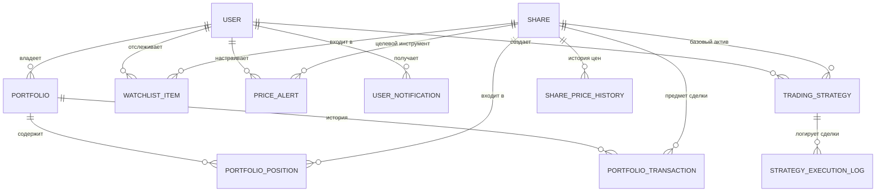

# Спецификация и требования к новой функциональности (Задание №4)

Настоящий документ подготовлен в рамках выполнения **Задания №4** программы домашнего задания проекта **Investing Demo**. В документе сформулированы требования к 4 новым подсистемам, описана обновленная архитектура, модель данных, алгоритмы обработки и сценарии использования.

---

## 1. Функциональные требования к новой функциональности

### 1.1. Модуль «Персональный мониторинг акций и ценовые алерты»
- **NFR-01 (Список наблюдения / Watchlist):**
  - Пользователь должен иметь возможность добавлять любую акцию из каталога в свой персональный список наблюдения (Watchlist) в один клик.
  - Пользователь должен иметь возможность удалять акцию из списка наблюдения.
  - Список наблюдения должен отображать только инструменты, добавленные текущим аутентифицированным пользователем.
- **NFR-02 (Целевые ценовые уровни / Alerts):**
  - Пользователь должен иметь возможность установить ценовой уровень для любой акции с условием:
    - *«Выше или равно»* (рост до целевой цены);
    - *«Ниже или равно»* (падение до целевой цены).
  - Система должна поддерживать статусы алерта: активен (`is_active`), сработал (`is_triggered`), архив.
- **NFR-03 (Уведомления без дублирования):**
  - При изменении рыночной цены акции система автоматически проверяет все активные алерты.
  - При выполнении условия создается внутрисистемное уведомление (`UserNotification`).
  - Флаг `is_triggered` переводится в `True`, что исключает повторную отправку уведомлений об одном и том же событии.
  - Пользователь видит индикатор непрочитанных уведомлений (колокольчик) в шапке сайта и может отмечать их как прочитанные.

---

### 1.2. Модуль «Виртуальный инвестиционный портфель»
- **NFR-04 (Управление портфелем и балансом):**
  - Для каждого зарегистрированного пользователя создается персональный инвестиционный портфель с виртуальным стартовым балансом (по умолчанию 100 000 руб.).
  - Система отображает свободный остаток денежных средств (`cash_balance`), общую стоимость инвестированных активов и суммарную стоимость портфеля (`total_portfolio_value`).
- **NFR-05 (Моделирование операций покупки):**
  - Пользователь может совершить виртуальную покупку любого количества акций по их текущей рыночной цене.
  - Система валидирует достаточность свободных средств (`cash_balance >= quantity * price`).
  - При покупке списываются денежные средства, увеличивается количество акций в позиции и пересчитывается средневзвешенная цена приобретения (`average_buy_price`).
  - Каждая операция покупки фиксируется в истории транзакций (`PortfolioTransaction`).
- **NFR-06 (Моделирование операций продажи):**
  - Пользователь может продать часть или все акции из открытой позиции по текущей рыночной цене.
  - Система проверяет наличие достаточного количества акций в портфеле.
  - При продаже средства зачисляются на баланс портфеля, количество акций уменьшается (при полном закрытии позиция удаляется или обнуляется).
  - Операция продажи фиксируется в журнале транзакций.
- **NFR-07 (Расчет прибыли и доходности):**
  - По каждой позиции рассчитывается:
    - Текущая стоимость: `quantity * share.last_price`;
    - Финансовый результат (P&L): `(share.last_price - average_buy_price) * quantity`;
    - Доходность в процентах: `((share.last_price / average_buy_price) - 1) * 100%`.
  - По портфелю в целом рассчитывается общий нереализованный P&L и процент доходности.
- **NFR-08 (Журнал операций):**
  - Просмотр хронологической истории всех покупок и продаж с указанием даты, тикера, типа операции (BUY/SELL), цены, количества и итоговой суммы.

---

### 1.3. Модуль «История изменения рыночных цен и аналитика»
- **NFR-09 (Хранение исторических котировок):**
  - Система автоматически сохраняет котировку акции в локальную таблицу `SharePriceHistory` при каждом обновлении цен.
- **NFR-10 (Анализ динамики и периоды):**
  - Просмотр истории изменения цен по выбранным интервалам: 1 день, 1 неделя, 1 месяц, 6 месяцев, 1 год, всё время.
  - Автоматический расчет:
    - Абсолютного изменения цены: `ΔP = P_текущая - P_начальная`;
    - Процентного изменения стоимости: `% = (ΔP / P_начальная) * 100%`.
- **NFR-11 (Графики на основе накопленных данных):**
  - Построение интерактивных графиков Plotly на базе локальных накопленных данных из БД без обязательного обращения к сторонним API.

---

### 1.4. Модуль «Симулятор инвестиционных стратегий»
- **NFR-12 (Конфигурация торговых стратегий):**
  - Пользователь может создавать автоматические стратегии для выбранной акции:
    - Имя стратегии (например, *«Покупка на просадке»*);
    - Порог покупки (`buy_threshold`: покупка, если цена $\le$ порога);
    - Порог продажи (`sell_threshold`: фиксация прибыли, если цена $\ge$ порога);
    - Объем одной сделки (`trade_quantity`).
  - Выделенный виртуальный капитал стратегии (по умолчанию 50 000 руб.).
- **NFR-13 (Автоматическое моделирование сделок):**
  - При изменении рыночной цены акции система автоматически проверяет условия активных стратегий.
  - Если цена удовлетворяет условию покупки и у стратегии достаточно капитала — симулятор совершает виртуальную покупку.
  - Если цена удовлетворяет условию продажи и на балансе стратегии есть удерживаемые акции — симулятор совершает виртуальную продажу.
- **NFR-14 (Журнал сделок и оценка эффективности):**
  - Ведение детального журнала сделок стратегии (`StrategyExecutionLog`).
  - Расчет финансового результата стратегии: текущий капитал + стоимость удерживаемых акций vs начальный капитал, расчет абсолютной и процентной доходности стратегии.

---

## 2. Архитектурные изменения и модель данных

---

## 3. План реализации в кодовой базе
1. Обновление [dashboard/models.py](dashboard/models.py): добавление моделей `Portfolio`, `PortfolioPosition`, `PortfolioTransaction`, `WatchlistItem`, `PriceAlert`, `UserNotification`, `SharePriceHistory`, `TradingStrategy`, `StrategyExecutionLog`.
2. Создание и применение миграций Django (`makemigrations`, `migrate`).
3. Реализация сервисного слоя бизнес-логики:
   - Сервис портфеля (`portfolio_service.py`): покупка, продажа, расчет P&L.
   - Сервис мониторинга и алертов (`alerts_service.py`): проверка условий, уведомления без дублей.
   - Сервис стратегий (`strategy_service.py`): исполнение правил стратегий.
4. Добавление веб-представлений (Views) и шаблонов:
   - Раздел «Портфель» (`portfolio.html`, `transaction_history.html`);
   - Раздел «Мониторинг и алерты» (`watchlist.html`, модальные окна алертов);
   - Раздел «История цен и аналитика» (`price_history.html`);
   - Раздел «Симулятор стратегий» (`strategies.html`).
5. Интеграция с навигационной панелью [dashboard/templates/dashboard/base.html](dashboard/templates/dashboard/base.html).
6. Написание автоматизированных тестов для всех 4 подсистем.
